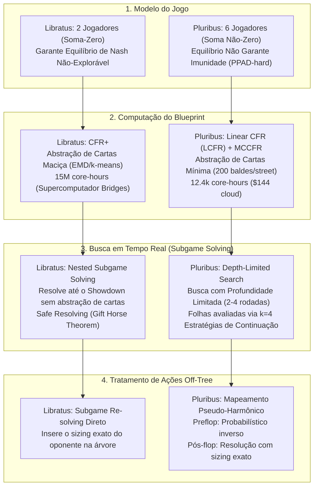
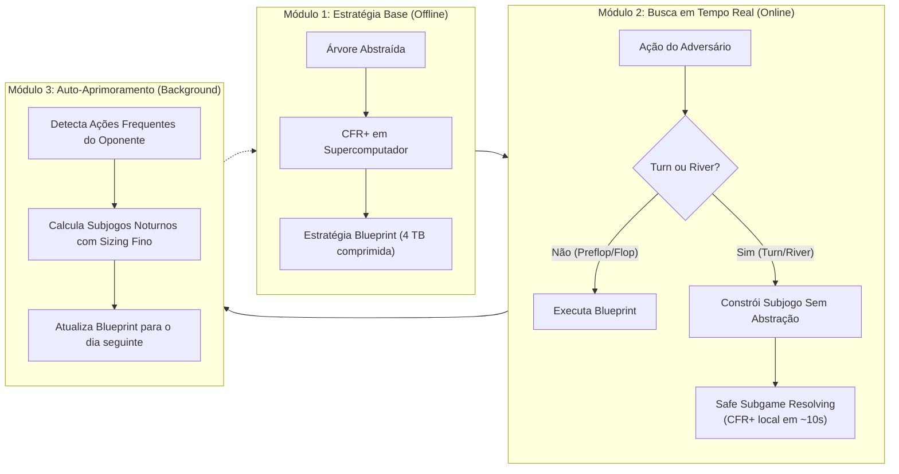
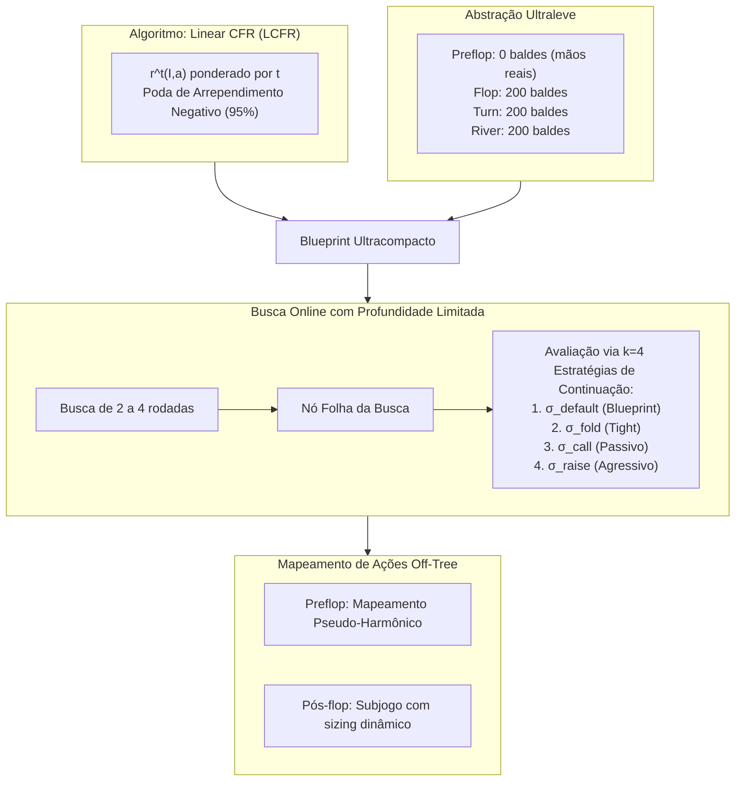
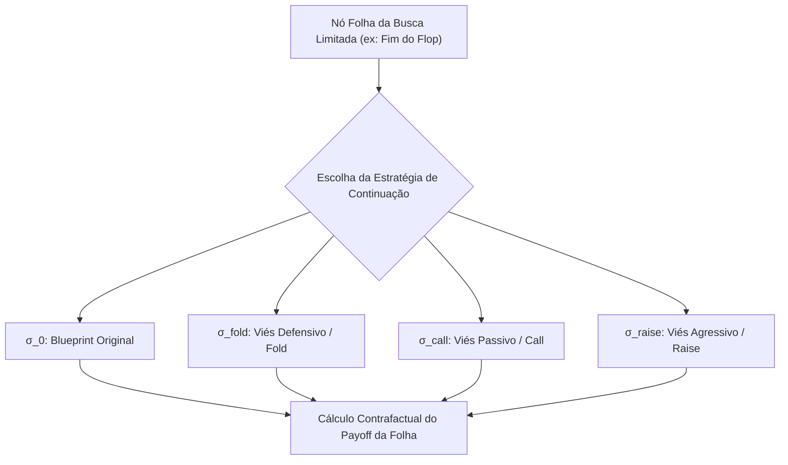
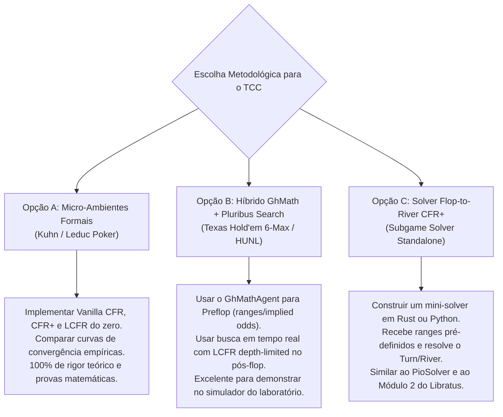

# 📚 Estudo Comparativo e Arquitetural: Libratus vs. Pluribus
## Fundamentos Matemáticos, Algorítmicos e Práticos para TCC em Inteligência Artificial para Poker

> **Autor do TCC:** Gustavo (GH)  
> **Área:** Ciência da Computação / Inteligência Artificial / Teoria dos Jogos Algorítmica  
> **Obras Analisadas:**
> 1. Brown, N., & Sandholm, T. (2018). *Superhuman AI for heads-up no-limit poker: Libratus beats top professionals*. **Science**, 359(6374), 418-424.
> 2. Brown, N., & Sandholm, T. (2019). *Superhuman AI for multiplayer poker*. **Science**, 365(6456), 885-890.
> 3. Materiais Suplementares Oficiais (*Supplementary Materials*) de ambas as publicações.

---

## Sumário Executivo

Este documento sintetiza os pilares teóricos, matemáticos e de engenharia computacional dos dois maiores marcos da história da Inteligência Artificial aplicada ao Poker: o **Libratus** (que superou os melhores profissionais mundiais no *Heads-Up No-Limit Texas Hold'em* - HUNL em 2017) e o **Pluribus** (que superou a elite humana no Poker *6-Max No-Limit Texas Hold'em* em 2019).

O objetivo deste material é fornecer o embasamento teórico rigoroso e a estrutura metodológica necessários para compor os capítulos de **Fundamentação Teórica**, **Trabalhos Correlatos**, **Metodologia** e **Proposta Experimental** do seu Trabalho de Conclusão de Curso (TCC).

---

## 1. Fundamentos da Teoria dos Jogos para Poker (Capítulo 2 do TCC)

### 1.1 Formalização de Jogos na Forma Extensiva com Informação Imperfeita (IIEFG)
O Poker No-Limit Texas Hold'em é formalizado matematicamente como um **Jogo na Forma Extensiva com Informação Imperfeita** (*Imperfect-Information Extensive-Form Game* - IIEFG), caracterizado pela tupla:

$$\Gamma = \langle N, A, H, Z, \mathcal{P}, \sigma_c, u, \mathcal{I} \rangle$$

Onde:
1. $N = \{1, 2, \dots, n\}$ é o conjunto finito de jogadores.
2. $A$ é o conjunto universal de todas as ações possíveis (fold, check, call, bet/raise de valores variados).
3. $H$ é o conjunto de todas as sequências de ações (histórias ou nós da árvore). $\emptyset \in H$.
4. $Z \subseteq H$ é o conjunto de histórias terminais (onde a mão acaba por fold ou showdown).
5. $\mathcal{P}: H \setminus Z \to N \cup \{c\}$ é a função de vez de jogador, onde $c$ representa o jogador "Acaso" (*Chance/Natureza*, responsável por embaralhar e distribuir cartas).
6. $\sigma_c$ é a estratégia fixa da Chance (probabilidade uniforme de distribuição de cartas do baralho de 52 cartas).
7. $u = (u_1, u_2, \dots, u_n)$, onde $u_i: Z \to \mathbb{R}$ é a função de utilidade (payoff em fichas) para o jogador $i$.
8. $\mathcal{I} = (\mathcal{I}_1, \dots, \mathcal{I}_n)$ é a partição de informação. Para o jogador $i$, $\mathcal{I}_i$ particiona os nós $\{h \in H : \mathcal{P}(h) = i\}$ em **Conjuntos de Informação** (*Information Sets* ou *infosets*) $I \in \mathcal{I}_i$.

> **Conceito Chave:** Se $h, h' \in I$, o jogador $i$ não tem como distinguir em qual dos dois estados se encontra, pois as cartas fechadas do oponente são desconhecidas. Logo, a estratégia de $i$ deve ser idêntica para todos os nós dentro do mesmo $I$: $\sigma_i(h, a) = \sigma_i(h', a) = \sigma_i(I, a)$.

### 1.2 O Abismo Teórico: 2 Jogadores (Soma-Zero) vs. Multijogador ($n \ge 3$)

A transição de 2 jogadores para 6 jogadores não é apenas uma expansão combinatória; é uma **fronteira matemática intransponível** na Teoria dos Jogos:

#### 1.2.1 O Cenário de 2 Jogadores (Libratus)
No HUNL ($N = \{1, 2\}$, $u_1(z) + u_2(z) = 0$):
* **Teorema Minimax de John von Neumann (1928):**
  $$\max_{\sigma_1} \min_{\sigma_2} u_1(\sigma_1, \sigma_2) = \min_{\sigma_2} \max_{\sigma_1} u_1(\sigma_1, \sigma_2) = v_1^*$$
* **Garantia de Não-Explorabilidade:** Todo Equilíbrio de Nash $\sigma^* = (\sigma_1^*, \sigma_2^*)$ possui o mesmo valor de jogo $v_1^*$. Se o jogador 1 joga uma aproximação de Nash $\sigma_1^*$, o oponente não consegue obter utilidade esperada positiva contra ele, independentemente do que faça.
* **Intercambiabilidade:** Se $\sigma^*$ e $\sigma'$ são dois equilíbrios de Nash distintos, $(\sigma_1^*, \sigma_2')$ também é um equilíbrio de Nash.
* **Explorabilidade Formal:** Definida como a perda esperada contra o melhor respondedor (*Best Responder* $BR$):
  $$\text{Exploitability}(\sigma) = \frac{u_1(BR(\sigma_2), \sigma_2) + u_2(\sigma_1, BR(\sigma_1))}{2}$$
  Um equilíbrio exato tem explorabilidade $0$.

#### 1.2.2 O Cenário Multijogador (Pluribus)
No poker com $n \ge 3$ jogadores:
* **Perda do Teorema Minimax e da Intercambiabilidade:** Múltiplos equilíbrios de Nash coexistem e não são intercambiáveis.
* **O Paradoxo do Lemonade Stand / Colusão Indireta:** Em jogos com 3 ou mais participantes, jogar uma estratégia de Equilíbrio de Nash **NÃO GARANTE** que você não será explorado ou que terá lucro esperado! Se dois oponentes jogam de forma irracional ou colusiva (mesmo sem intenção), a transferência de fichas entre eles pode reduzir drasticamente o payoff do jogador equilibrado.
* **Complexidade Computacional (PPAD-Hard):** Daskalakis, Goldberg & Papadimitriou (2009) provaram que calcular um Equilíbrio de Nash em jogos com 3 ou mais jogadores é **PPAD-completo** (*Polynomial Parity Arguments on Directed Graphs*). Não existe algoritmo em tempo polinomial conhecido, sendo computacionalmente intratável buscar o equilíbrio exato.
* **A Ruptura Conceitual de Pluribus:** Pluribus **abandona formalmente** a busca por um Equilíbrio de Nash canônico. Em vez disso, adota uma estratégia empírica obtida por auto-jogo (*self-play*), provando que, embora não seja invulnerável na teoria matemática pura, na prática ela supera de forma consistente e esmagadora as heurísticas humanas e estratégias exploratórias conhecidas.

---

## 2. A Arquitetura do Libratus (Brown & Sandholm, 2018)

O Libratus opera sobre uma arquitetura de três módulos interdependentes:

### 2.1 Módulo 1: Algoritmo CFR+ e Abstrações

#### 2.1.1 O Algoritmo Counterfactual Regret Minimization Plus (CFR+)
O CFR tradicional (Zinkevich et al., 2007) minimiza o arrependimento contrafactual cumulativo em cada infoset. O arrependimento contrafactual imediato de não ter tomado a ação $a$ na iteração $t$ é:

$$r^t(I, a) = v^{\sigma^t}(I, a) - v^{\sigma^t}(I)$$

Onde $v^{\sigma^t}(I, a)$ é o valor contrafactual de tomar $a$ no infoset $I$ supondo que o jogador tentou alcançar $I$ com probabilidade 1, ponderado pela probabilidade dos outros jogadores alcançarem $I$.

O **CFR+** (Tammelin et al., 2014) introduz duas modificações decisivas que aceleram drasticamente a convergência:
1. **Piso de Arrependimento em Zero (*Regret Matching+*):**
   $$R_+^T(I, a) = \max\left(0, R_+^{T-1}(I, a) + r^T(I, a)\right)$$
   Ao zerar arrependimentos negativos imediatamente em vez de deixá-los acumular no negativo, ações que foram temporariamente ruins recuperam relevância rapidamente caso a dinâmica mude.
2. **Média Ponderada Linear da Estratégia:**
   $$\bar{\sigma}^T(I, a) = \frac{\sum_{t=1}^T t \cdot \sigma^t(I, a) \cdot \pi_i^{\sigma^t}(I)}{\sum_{t=1}^T t \cdot \pi_i^{\sigma^t}(I)}$$
   Ao atribuir peso $t$ à iteração $t$, as primeiras iterações (que contêm ruído caótico do início do treinamento) são rapidamente descartadas.

#### 2.1.2 Abstração de Cartas (*Information Abstraction*)
A árvore do HUNL tem mais de $10^{160}$ nós de decisão. O Libratus utiliza:
* **Preflop e Flop:** Resolução quase completa de cartas (pouca ou nenhuma abstração).
* **Turn e River:** Agrupamento de mãos (*Hand Clustering*) em $\sim 10^7$ baldes (*buckets*). O agrupamento é feito via algoritmo **Earth Mover's Distance (EMD)** aplicado sobre a distribuição de transição para o river, medindo a similaridade futura de equidade (*potential-aware abstraction*).

#### 2.1.3 Abstração de Apostas (*Action Abstraction*)
Libratus restringe os tamanhos de aposta contínuos a um menu discreto:
* Rodadas iniciais (Preflop/Flop): Potes fracionários como $0.5\times$, $1.0\times$, $2.0\times$ o pote, e All-in.
* Rodadas finais (Turn/River): Menus densos de apostas contendo até 8 sizings distintos.

---

### 2.2 Módulo 2: *Nested Subgame Solving* e *Safe Resolving*

A grande inovação de Libratus que garantiu sua vitória contra os humanos foi o **Nested Subgame Solving**.

#### O Problema Clássico de Subjogos em Jogos com Informação Imperfeita
Em xadrez, um subtabuleiro pode ser resolvido isoladamente porque o estado das peças é público. No Poker, um subjogo **não pode** ser resolvido isoladamente porque o valor de uma mão depende da **distribuição de probabilidade do oponente sobre todas as mãos possíveis que ele poderia ter dado a sequência de ações anterior** (vetor de probabilidades de alcance, *reach probabilities* $\pi_{-i}$).

Se o agente recalcular o Turn de forma ingênua, o oponente humano pode "blefar no pré-flop" para forçar o agente a cair em um subjogo onde o humano possui mãos inesperadas, explorando a estratégia local (*Reconstruction Trap*).

#### A Solução do Libratus: *Safe Subgame Resolving* (Gift Horse Theorem)
No Libratus, ao atingir o Turn ou o River, é gerada em tempo de execução uma nova árvore de jogo a partir daquele ponto exato até o Showdown:
1. **Resolução Plena de Cartas:** A árvore do subjogo usa **zero abstração de cartas**. Todas as $1.326$ combinações de cartas iniciais são calculadas sem perda de granularidade.
2. **Estrutura de Salvaguarda (*Gift Horse*):** Para evitar que a resolução do subjogo seja explorável, é permitida ao oponente uma ação hipotética alternativa de "sair do subjogo e receber o valor contrafactual que ele recebia no Blueprint original":

$$v_{-i}^{resolved}(I) \le v_{-i}^{blueprint}(I)$$

O *Gift Horse Theorem* (Burch, Johanson, Bowling 2014; Brown & Sandholm 2017) prova matematicamente que, ao impor esse teto de utilidade ao oponente, a estratégia combinada (Blueprint no topo + Subgame Solver na base) tem **garantia formal de que sua explorabilidade global nunca aumenta**.

---

### 2.3 Módulo 3: O Módulo de Auto-Aprimoramento Noturno

Durante o desafio contra os profissionais humanos, os humanos tentavam encontrar "brechas" na abstração de apostas do Libratus (por exemplo, apostando valores não previstos no blueprint, como $1.25\times$ o pote).
* O Módulo 3 monitorava os sizings mais utilizados pelos humanos durante o dia.
* À noite, os supercomputadores Bridges recalculavam o Blueprint global adicionando esses sizings específicos nos ramos mais visitados.
* Na manhã seguinte, as ramificações onde os humanos acreditavam ter encontrado uma vantagem já estavam densamente integradas ao equilíbrio.

---

## 3. O Salto Revolucionário do Pluribus (Brown & Sandholm, 2019)

Se o Libratus foi a consagração da força computacional bruta e da teoria de jogos de 2 jogadores, o **Pluribus** representou uma quebra de paradigma em eficiência algorítmica: ele resolveu o poker de 6 jogadores gastando **menos de 0,1% dos recursos computacionais** do Libratus.

### 3.1 Linear Counterfactual Regret Minimization (LCFR)

O Pluribus introduz o **Linear CFR (LCFR)**, que supera tanto o CFR padrão quanto o CFR+ quando combinado com algoritmos de amostragem de Monte Carlo (*MCCFR*).

#### Formulação Matemática do LCFR
No LCFR, tanto os arrependimentos acumulados quanto as estratégias médias são ponderados linearmente pelo índice da iteração $t$:

$$R^T(I, a) = \sum_{t=1}^T t \cdot r^t(I, a)$$

$$\bar{\sigma}^T(I, a) = \frac{\sum_{t=1}^T t \cdot \sigma^t(I, a) \cdot \pi_{-i}^{\sigma^t}(I)}{\sum_{t=1}^T t \cdot \pi_{-i}^{\sigma^t}(I)}$$

Se um arrependimento cumulativo for negativo, ele é descontado a cada iteração:
$$R^t(I, a) = R^{t-1}(I, a) \cdot \frac{t-1}{t+1} \quad \text{se } R^{t-1}(I, a) < 0$$

#### Poda de Arrependimento Negativo (*Negative Regret Pruning*)
Se uma ação tiver um arrependimento muito negativo ($R(I, a) < -C$), o Pluribus salta a exploração dessa ação em 95% das iterações de amostragem. Isso reduz a complexidade de tempo do Monte Carlo em mais de 70% sem degradar a convergência.

---

### 3.2 Abstração de Cartas Minimalista
Enquanto o Libratus utilizava supercomputadores para gerenciar centenas de milhões de clusters de cartas calculados via EMD, o Pluribus utilizou uma abstração surpreendentemente simples:
* **Preflop:** Nenhuma abstração (todas as 169 classes de mãos isomórficas são modeladas).
* **Flop:** Mãos agrupadas em apenas **200 baldes**.
* **Turn:** Mãos agrupadas em apenas **200 baldes**.
* **River:** Mãos agrupadas em apenas **200 baldes**.

> **Por que isso funcionou?**  
> Brown e Sandholm perceberam que a precisão no pós-flop não precisa vir do Blueprint! O Blueprint só precisa fornecer uma orientação estratégica macroeconômica. A verdadeira precisão tática e o cálculo fino de equidade são transferidos para a **Busca em Tempo Real** (*Real-Time Search*).

---

### 3.3 A Joia da Coroa: Busca em Tempo Real com Profundidade Limitada (*Depth-Limited Search*)

Em jogos de 6 jogadores, a árvore cresce na ordem de $O(|A|^{6 \times \text{streets}})$. É matematicamente impossível resolver um subjogo até o Showdown em tempo real (como fazia o Libratus no 1v1).

O Pluribus resolveu isso inventando a **Busca em Tempo Real com Profundidade Limitada para Jogos com Informação Imperfeita**:

#### O Dilema do Nó Folha em Informação Imperfeita
Em jogos de informação perfeita (Xadrez/Go), cortar a busca a 10 jogadas de profundidade é trivial: passa-se o estado do tabuleiro por uma função de valor estática (heurística ou rede neural do AlphaZero) que retorna um número escalar $V(s)$.

No Poker, **uma função heurística estática escalar não funciona**. O valor de um estado no turn não depende apenas das cartas visíveis; ele depende intimamente de:
1. Como o herói jogaria com as *outras* mãos do seu range que não chegaram até ali.
2. Como os 5 oponentes jogariam até o final da mão com suas respectivas mãos ocultas.

Se um jogador souber que o avaliador da folha assume que ele sempre aposta forte no river com mãos médias, o oponente no nó raiz ajusta sua estratégia para puni-lo brutalmente.

#### A Invenção do Pluribus: Folhas Avaliadas por $k=4$ Perfis de Estratégias de Continuação
Para avaliar uma folha $z_{leaf}$ localizada no final de uma rodada de apostas (por exemplo, no final do Turn), o Pluribus não utiliza um número arbitrário. Ele assume que, a partir daquela folha até o final do jogo, cada participante adotará uma estratégia de continuação baseada no Blueprint, mas com flexibilidade estratégica!

O Pluribus define $k = 4$ estratégias de continuação pré-computadas para cada jogador:
1. $\sigma_0$ (**Default/Unbiased**): A estratégia original do Blueprint.
2. $\sigma_{fold}$ (**Tight/Candidata a desistência**): O Blueprint alterado para dar fold com 100% de probabilidade caso enfrente uma aposta no river.
3. $\sigma_{call}$ (**Passiva/Candidata a pagar**): O Blueprint alterado para sempre dar call em vez de raise no river.
4. $\sigma_{raise}$ (**Agressiva/Candidata a aumento**): O Blueprint alterado para aumentar a frequência de raise com as melhores mãos e blefes.

Ao permitir que os jogadores no subjogo possam escolher, para cada uma de suas mãos possíveis, qual das 4 estratégias de continuação adotar a partir da folha, **o Pluribus impede que o oponente explore a profundidade limitada da busca**, garantindo estabilidade e equilíbrio sem precisar calcular até o showdown!

---

### 3.4 Tratamento de Apostas Fora da Árvore (*Off-Tree Actions*)

Quando um jogador humano faz uma aposta cujo tamanho não está na árvore discreta do bot:

#### 3.4.1 No Libratus
O Libratus simplesmente suspendia o jogo e rodava uma rodada de *Subgame Resolving* inserindo exatamente aquele nó com o valor exato apostado pelo adversário. Como ele rodava em supercomputadores com centenas de threads, podia gerar novos ramos instantaneamente.

#### 3.4.2 No Pluribus
* **No Pré-flop:** Utiliza o **Mapeamento Pseudo-Harmônico** (*Pseudo-Harmonic Action Mapping*, Barker et al., 2013).  
  Se o oponente aposta um valor $x$ entre duas ações modeladas na árvore $A$ e $B$ ($A < x < B$), a probabilidade de mapear a ação como se fosse $A$ é:
  $$P(A) = \frac{B - x}{B - A} \cdot \frac{A + pot}{x + pot}$$
  $$P(B) = 1 - P(A)$$
  Esse mapeamento preserva a propriedade de que o valor esperado marginal da aposta mapeada não oferece incentivo ao oponente para explorar os intervalos entre os sizings da árvore.
* **No Pós-flop:** Como a busca é de profundidade limitada e consome apenas 28 núcleos normais, o Pluribus recalcula a busca em tempo real adicionando o tamanho exato da aposta do adversário na árvore local em menos de 20 segundos.

---

## 4. Matriz Comparativa Integral: Libratus vs. Pluribus

A tabela a seguir resume as diferenças arquiteturais e operacionais fundamentais para a sua fundamentação de TCC:

| Critério de Comparação | Libratus (Brown & Sandholm, 2018) | Pluribus (Brown & Sandholm, 2019) | Relevância Metodológica para o TCC |
| :--- | :--- | :--- | :--- |
| **Modalidade do Jogo** | 2 Jogadores (HUNL) | 6 Jogadores (6-Max NLHE) | Mostra a transição de jogo 1v1 para ambientes sociais e colaborativos/competitivos. |
| **Classe de Jogo Teórico** | Soma-Zero de 2 Jogadores | Soma Não-Zero de $N$ Jogadores | Teorema Minimax é válido apenas no 1v1; multijogador é PPAD-completo. |
| **Garantia Teórica de Nash** | Nash Equilibrium = Não-Explorável | Nash não garante imunidade | Pluribus busca *Superhuman Empirical Play* via self-play; não busca Nash formal. |
| **Algoritmo de Blueprint** | CFR+ com Regret Matching+ | Linear CFR (LCFR) com Negative Regret Pruning | LCFR converge muito mais rápido com amostragem de Monte Carlo (MCCFR). |
| **Amostragem no Blueprint** | Traversals completos / Vanilla CFR | External Sampling MCCFR | Reduz dramaticamente a memória necessária durante o treinamento. |
| **Abstração de Cartas** | EMD com $\sim 10^7$ baldes no Turn/River | Apenas 200 baldes por street pós-flop | Prova que blueprints ultraleves funcionam se houver busca em tempo real. |
| **Busca em Tempo Real** | Nested Subgame Solving até o Showdown | Depth-Limited Search (2-4 rodadas) | Resolver até o showdown é intratável em 6-max; depth-limited é obrigatório. |
| **Avaliação de Folhas da Busca** | Não tem folhas (vai até o Showdown) | $k=4$ Perfis de Estratégias de Continuação | Grande contribuição teórica do Pluribus para jogos de informação imperfeita. |
| **Hardware de Treinamento** | Supercomputador Bridges (15.000.000 core-hours) | 1 Servidor de 64 núcleos (12.400 core-hours) | Pluribus é $1.200\times$ mais econômico computacionalmente. |
| **Custo de Nuvem Estimado** | Milhões de dólares em supercomputação | $\approx \$144$ dólares em instâncias AWS | Demonstra que IAs de ponta tornaram-se acessíveis à pesquisa acadêmica. |
| **Hardware de Execução Local** | Dezenas de nós de supercomputador | 1 Máquina com 2 processadores Intel Xeon (28 cores, 256 GB RAM) | Viável de ser aproximado com otimizações e simplificações em laboratório. |
| **Módulo de Auto-Melhoria** | Sim (Módulo 3 noturno no supercomputador) | Não utilizado (Busca local foi suficiente) | Simplifica a arquitetura de produção em tempo real. |

---

## 5. Diretrizes e Recomendações Práticas para o seu TCC

Ao desenvolver um TCC de graduação em Ciência da Computação, tentar reproduzir o Libratus ou o Pluribus na íntegra para o No-Limit Texas Hold'em completo é inviável devido aos limites de tempo e infraestrutura. No entanto, a literatura desses dois artigos fornece as ferramentas exatas para você construir um trabalho de altíssimo nível científico e prático.

Aqui estão as três alternativas recomendadas para a sua proposta metodológica:

### 5.1 Opção A: Comparação Algorítmica nos Jogos-Padrão Kuhn e Leduc (Recomendação Acadêmica Pura)
* **Jogos:** **Kuhn Poker** (baralho de 3 cartas, 1 rodada) e **Leduc Hold'em** (baralho de 6 cartas, 2 rodadas, cartas comunitárias).
* **Escopo:**
  1. Implementar do zero em Python (ou C++/Rust) os algoritmos:
     * Vanilla CFR (Zinkevich, 2007)
     * CFR+ (Tammelin / Libratus, 2014)
     * Linear CFR (Pluribus, 2019)
  2. Plotar gráficos de:
     * Taxa de convergência da explorabilidade ($\text{Exploitability} \times \text{Iterações}$).
     * Consumo de memória e impacto do *Negative Regret Pruning*.
* **Vantagens para o TCC:** Provas matemáticas exatas, sem necessidade de supercomputadores, roda em segundos no seu laptop, e demonstra domínio absoluto da literatura de ponta.

### 5.2 Opção B: Arquitetura Híbrida `GhMathAgent` + Busca Inspirada no Pluribus (Recomendação de Engenharia)
* **Escopo:**
  1. No **Pré-flop**: Manter o motor analítico que você já projetou (`GhMathAgent`), utilizando ranges posicionais, pot odds dinâmicas e Critério de Kelly.
  2. No **Pós-flop (Flop, Turn, River)**: Implementar uma rotina de busca local simplificada inspirada no Pluribus:
     * Discretizar o espaço de cartas em baldes de Equidade Atual ($EHS$) e Potencial ($EHS^2$).
     * Rodar 1.000 iterações de MCCFR local com profundidade de 1 street à frente para escolher a melhor ação probabilística.
  3. Colocar o agente híbrido para duelar contra o bot do Alberto e os bots heurísticos no seu script de benchmark.
* **Vantagens para o TCC:** Integração direta com a base de código já existente no repositório (`src/agents/`), resolvendo o jogo completo de forma elegante e prática.

### 5.3 Notação Matemática Padronizada para os seus Capítulos
Ao redigir seu texto, utilize a convenção oficial adotada por Noam Brown e Tuomas Sandholm:
* $I \in \mathcal{I}_i$: Conjunto de Informação do jogador $i$.
* $\sigma(I) \in \Delta(A(I))$: Estratégia mista no infoset $I$.
* $\sigma_i$: Estratégia completa do jogador $i$ em toda a árvore.
* $\sigma_{-i}$: Estratégia de todos os outros jogadores exceto $i$.
* $\pi^{\sigma}(h)$: Probabilidade de alcançar a história $h$ sob o perfil de estratégia $\sigma$.
* $\pi_i^{\sigma}(h)$: Contribuição do jogador $i$ para a probabilidade de alcançar $h$.
* $\pi_{-i}^{\sigma}(h)$: Contribuição de todos os oponentes e da Chance para alcançar $h$.
* $v_i^{\sigma}(I)$: Valor contrafactual para o jogador $i$ no infoset $I$.
* $r^t(I, a)$: Arrependimento contrafactual imediato na iteração $t$.
* $R^T(I, a)$: Arrependimento contrafactual cumulativo após $T$ iterações.

---

## 6. Referências Bibliográficas Essenciais (Formato ABNT / BibTeX)

1. **BROWN, Noam; SANDHOLM, Tuomas.** Superhuman AI for heads-up no-limit poker: Libratus beats top professionals. *Science*, v. 359, n. 6374, p. 418-424, 2018.
2. **BROWN, Noam; SANDHOLM, Tuomas.** Superhuman AI for multiplayer poker. *Science*, v. 365, n. 6456, p. 885-890, 2019.
3. **BROWN, Noam; SANDHOLM, Tuomas.** Safe and nested subgame solving for imperfect-information games. In: *Advances in Neural Information Processing Systems (NeurIPS)*, p. 689-699, 2017.
4. **TAMMELIN, Oskari et al.** Solving Heads-Up Limit Texas Hold'em. In: *International Joint Conference on Artificial Intelligence (IJCAI)*, 2015.
5. **ZINKEVICH, Martin et al.** Regret minimization in games with incomplete information. In: *Advances in Neural Information Processing Systems (NeurIPS)*, v. 20, 2007.
6. **DASKALAKIS, Constantinos; GOLDBERG, Paul W.; PAPADIMITRIOU, Christos H.** The complexity of computing a Nash equilibrium. *SIAM Journal on Computing*, v. 39, n. 1, p. 195-259, 2009.
