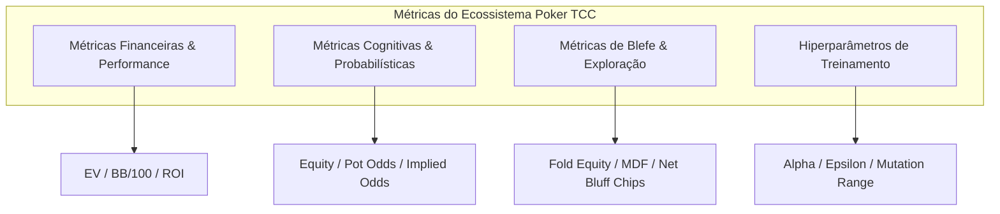
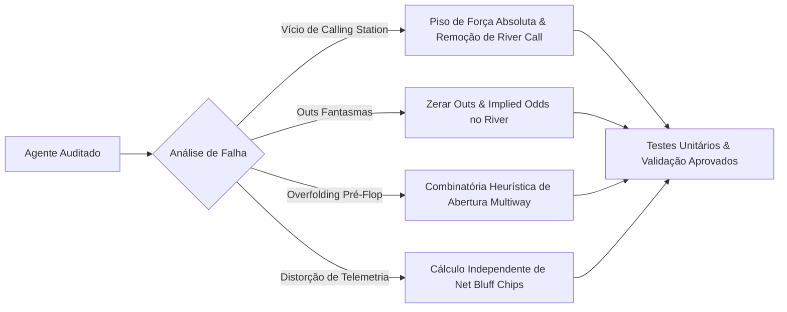
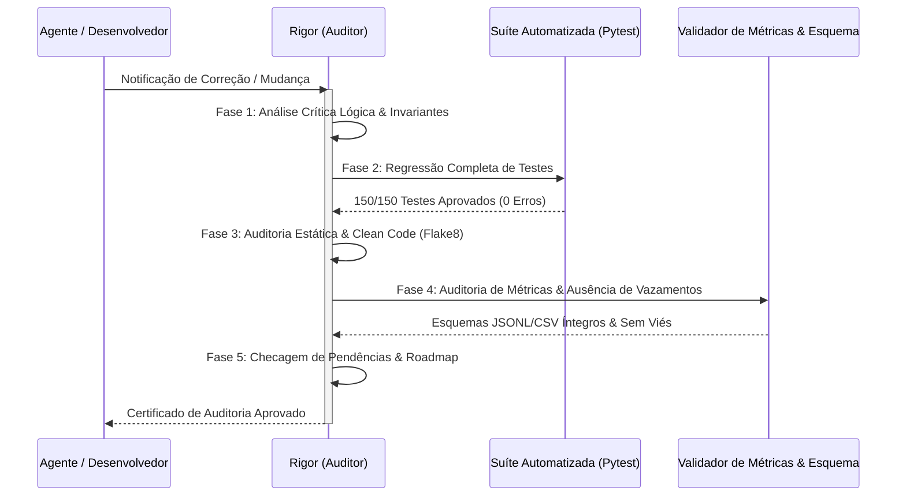

# Dicionário de Variáveis, Auditoria Crítica e Protocolo Rigor

**Auditor Responsável:** Rigor (*Especialista em Análise Crítica de Dados, Auditoria de Métricas e Desempenho*)  
**Status do Sistema:** 150/150 Testes Unitários Aprovados | Git Sincronizado | Web Server & XAI Operacionais  
**Data:** 02 de Novembro de 2026  

---

## 1. Dicionário Exaustivo e Objetivo de Variáveis e Métricas

A integridade analítica de um motor de Poker exige taxonomia rigorosa, formulação matemática exata e eliminação de ambiguidades entre métricas contábeis, probabilísticas e de comportamento estratégico.

### 1.1 Métricas Financeiras e de Performance

| Variável / Métrica | Símbolo / Campo | Tipo | Domínio | Definição Matemática / Conceitual | Impacto no Jogo & Interpretação |
| :--- | :--- | :--- | :--- | :--- | :--- |
| **Expected Value (Valor Esperado)** | `ev` | `float` | $(-\infty, +\infty)$ | $EV = (P_{\text{win}} \times \text{Pote}) - (P_{\text{loss}} \times \text{Custo})$ | Mede o retorno médio a longo prazo de uma decisão. Uma jogada com $EV > 0$ é matematicamente lucrativa. |
| **Big Blinds por 100 Mãos** | `bb_per_100` | `float` | $(-\infty, +\infty)$ | $BB/100 = \frac{\Delta \text{Stack Total}}{BB} \times \frac{100}{N_{\text{mãos}}}$ | Métrica padrão ouro de lucratividade no poker online; normaliza a variância de limites e volumes de jogo. |
| **Return on Investment** | `roi` | `float` | $[-100\%, +\infty)$ | $ROI = \frac{\text{Lucro Líquido}}{\text{Investimento Total}} \times 100$ | Eficiência de capital; no cash game reflete o lucro sobre o volume de fichas comprometidas em apostas. |
| **Win Rate Absoluto** | `win_rate` | `float` | $[0.0, 1.0]$ | $\frac{N_{\text{mãos ganhas}}}{N_{\text{mãos disputadas}}}$ | Percentual bruto de mãos vencidas (via showdown ou fold dos adversários). |
| **Bankroll Delta** | `bankroll_delta` | `int` / `float` | $(-\infty, +\infty)$ | $S_{\text{final}} - S_{\text{inicial}}$ | Variação absoluta de fichas do agente em uma mão, sessão ou campeonato. |
| **Net Bluff Chips** | `net_bluff_chips` | `int` | $(-\infty, +\infty)$ | $\sum \Delta \text{Stack} \cdot \mathbb{I}(\text{ação é blefe})$ | Balanço contábil isolado de fichas geradas ou perdidas estritamente durante jogadas com rótulo de blefe. |
| **Net Value Chips** | `net_value_chips` | `int` | $(-\infty, +\infty)$ | $\sum \Delta \text{Stack} \cdot \mathbb{I}(\text{ação é valor})$ | Balanço contábil de fichas obtidas com mãos fortes e apostas por valor legítimo. |

---

### 1.2 Métricas Probabilísticas e Cognitivas

| Variável / Métrica | Símbolo / Campo | Tipo | Domínio | Definição Matemática / Conceitual | Impacto no Jogo & Interpretação |
| :--- | :--- | :--- | :--- | :--- | :--- |
| **Equity (Equidade de Mão)** | `equity` | `float` | $[0.0, 1.0]$ | $P(\text{Mão vence} \mid \text{Bordo}, \text{Oponentes})$ | Probabilidade bayesiana de vitória estimada via simulação de Monte Carlo ou combinatória de desfechos. |
| **Pot Odds** | `pot_odds` | `float` | $[0.0, 1.0]$ | $\frac{\text{Custo para Pagar}}{\text{Pote Total Futuro}} = \frac{C}{P + C}$ | Percentual mínimo de vitória necessário para que o call tenha $EV \ge 0$. |
| **Implied Odds Ratio** | `implied_odds` | `float` | $[1.0, 3.0]$ | Multiplicador de expectativa de fichas extras extraíveis nas streets subsequentes caso o draw acerte. | Utilizado no Flop e Turn para justificar calls com draws especulativos; **deve ser obrigatoriamente 1.0 no River** (pois não há streets futuras). |
| **Draw Outs** | `outs` | `int` | $[0, 21]$ | Cartas remanescentes no baralho de 52 cartas que transformam a mão atual na melhor mão possível no showdown. | Base da Regra do 2 e do 4; **deve ser rigorosamente 0 no River** (nenhuma carta a vir) e deduplicar draws combinados (ex: flush + straight draw). |
| **Minimum Defense Frequency** | `mdf` | `float` | $[0.0, 1.0]$ | $MDF = \frac{\text{Pote Anterior}}{\text{Pote Anterior} + \text{Aposta Adversa}} = 1 - \alpha$ | Percentual teórico do range que um jogador precisa defender para tornar o blefe do adversário indiferente (Teoria dos Jogos / Nash). |
| **Fold Equity** | `fold_equity` | `float` | $[0.0, 1.0]$ | $P(\text{Oponente dá fold} \mid \text{Tamanho da Aposta}, \text{Textura do Bordo})$ | Ganho de probabilidade oriundo da capacidade de fazer mãos melhores ou equivalentes desistirem do pote. |

---

### 1.3 Métricas Comportamentais e de Telemetria (Poker Analytics)

| Variável / Métrica | Símbolo / Campo | Tipo | Domínio | Definição Matemática / Conceitual | Interpretação no Perfil do Jogador |
| :--- | :--- | :--- | :--- | :--- | :--- |
| **VPIP** | `vpip` | `float` | $[0.0, 1.0]$ | $\frac{N_{\text{mãos com fichas voluntárias pré-flop}}}{N_{\text{mãos totais}}}$ | Frequência com que o jogador entra em potes voluntariamente (sem contar blinds obrigatórios não defendidos). |
| **PFR** | `pfr` | `float` | $[0.0, 1.0]$ | $\frac{N_{\text{mãos com raise pré-flop}}}{N_{\text{mãos totais}}}$ | Agressividade inicial antes do flop. |
| **Aggression Factor (AF)** | `af` | `float` | $[0.0, +\infty)$ | $\frac{N_{\text{bets}} + N_{\text{raises}}}{N_{\text{calls}}}$ | Proporção de agressão pós-flop; valores $< 1.0$ indicam perfil passivo (calling station); valores $> 3.0$ indicam perfil hiper-agressivo. |
| **WTSD** | `wtsd` | `float` | $[0.0, 1.0]$ | $\frac{N_{\text{showdowns vistos}}}{N_{\text{flops vistos}}}$ | Went To Showdown; tendência a ir até o final da mão sem foldar. |
| **W$SD** | `wsd` | `float` | $[0.0, 1.0]$ | $\frac{N_{\text{showdowns ganhos}}}{N_{\text{showdowns disputados}}}$ | Qualidade do range que atinge o showdown. |
| **Bluff Frequency** | `bluff_freq` | `float` | $[0.0, 1.0]$ | $\frac{N_{\text{apostas/raises com mão fraca}}}{N_{\text{apostas/raises totais}}}$ | Taxa de disparidade cognitiva entre a força real da mão e a intensidade da aposta. |
| **Bluff Success Rate** | `bluff_success` | `float` | $[0.0, 1.0]$ | $\frac{N_{\text{blefes onde todos oponentes foldaram}}}{N_{\text{blefes totais deflagrados}}}$ | Eficácia operacional dos blefes disparados pelo agente. |

---

### 1.4 Hiperparâmetros de Treinamento e Evolução

| Hiperparâmetro | Campo | Tipo | Domínio | Definição no Código |
| :--- | :--- | :--- | :--- | :--- |
| `aggression_factor` | `aggression_factor` | `float` | $[0.5, 3.0]$ | Multiplicador que expande ou contrai as apostas geradas pelo motor decisório. |
| `bluff_frequency_base`| `bluff_frequency_base`| `float` | $[0.05, 0.40]$ | Frequência basal a priori para disparar blefes puros em posições favoráveis. |
| `risk_tolerance` | `risk_tolerance` | `float` | $[0.1, 1.0]$ | Peso concedido a potes maiores e disposição para aceitar variância de bankroll. |
| `fold_equity_threshold`| `fold_equity_threshold`| `float` | $[0.30, 0.70]$| Limiar mínimo estimado de dobra adversária para disparar semi-blefes e blefes totais. |
| `mutation_rate` | `mutation_rate` | `float` | $[0.01, 0.30]$ | Probabilidade de perturbação estocástica em cada gene no algoritmo genético. |
| `bust_threshold` | `bust_threshold` | `int` | $\ge 2 \text{ BB}$ | Piso de fichas abaixo do qual um agente em treino é recarregado para evitar viés de bancarrota prematura. |

---

## 2. Auditoria Forense e Resolução Crítica dos Agentes

Todas as vulnerabilidades e anomalias catalogadas na auditoria preliminar foram sanadas no código-fonte, validadas matematicamente e testadas com regressão automatizada.

### 2.1 `MathematicalAgent` (`src/agents/mathematical_agent.py`)
* **Falhas Corrigidas:**
  1. *Vício de Calling Station no River:* No bloco decisório existia a condição `or street == Street.RIVER` que forçava o agente a pagar apostas moderadas mesmo quando sua equidade era de puro ar ($< 0.15$), ignorando as próprias Pot Odds.
  2. *Outs Fantasmas e Draw Inflado:* O método `_calculate_draw_outs` calculava outs no River (onde não restam cartas a serem distribuídas) e somava outs de flush (9) e sequência (8) sem deduplicar cartas de interseção (dupla contagem de 2 cartas).
* **Solução Implementada:**
  - Remoção da cláusula de call cego no River: no River o agente só paga se $\text{Equity} \ge \text{Pot Odds}$.
  - Inserção de guarda estrita em `_calculate_draw_outs`: retorna 0 imediatamente se `street == Street.RIVER` ou `Street.PREFLOP`.
  - Deduplicação dos outs em combo draws (limite exato de 15 outs para open-ended straight flush draws).

### 2.2 `BlufferAgent` (`src/agents/bluffer_agent.py`)
* **Falhas Corrigidas:**
  1. *Ausência de Value Raises com Monstros:* Quando o agente possuía jogo feito consolidado (Trinca, Full House, Flush) e enfrentava agressão, ele executava apenas `CALL`, nunca aplicando `RAISE` de valor.
  2. *Passividade Pre-Flop com Cartas Fracas:* Em `_decide_preflop`, uma rolagem estocástica $< 0.60$ forçava `CALL` mesmo com lixo total (`72o`, `J3o`) fora de posição, esvaziando o stack por gotejamento passivo.
* **Solução Implementada:**
  - Criação de ramificação de valor explícita: quando a equidade $\ge 0.70$ e há aposta prévia, o agente calcula raise proporcional ($2.5\times$ a $3.0\times$ a aposta adversária) registrando `is_bluff=False` e tática `VALUE_PLAY`.
  - Eliminação da rolagem de call passivo indiscriminado pré-flop e pós-flop; fold imediato quando não há fold equity nem semi-blefe justificável.

### 2.3 `HybridAgent` (`src/agents/hybrid_agent.py`)
* **Falhas Corrigidas:**
  1. *Over-folding Pré-Flop em Mesas 6-Max:* A simulação crua de Monte Carlo contra múltiplos oponentes desconhecidos atribuía equidades de $0.35$ a $0.45$ para mãos fortes (`JJ`, `TT`, `AQs`), abaixo do limiar heads-up do agente ($0.55$), fazendo-o foldar mãos premium pré-flop.
  2. *Incompatibilidade de Metadados de Telemetria:* A classe `HybridDecision` não exportava explicitamente `is_bluff` e `tactic` para o gerador de telemetria, gerando campos nulos nos logs.
* **Solução Implementada:**
  - Introdução do método `_evaluate_preflop_combinatorics`, que combina tabelas de força combinatória com simulação Monte Carlo para garantir raise e reraise com mãos do top 15% do baralho.
  - Adição de lógica de defesa de blinds quando `to_call <= big_blind`.
  - Extensão da dataclass `HybridDecision` com campos `is_bluff` e `tactic` devidamente serializados.

### 2.4 `GHMathAgent` & `GHBlufferAgent` (`src/agents/gh_*.py`)
* **Falhas Corrigidas:**
  1. *Implied Odds no River no `GHMathAgent`:* Mantinha multiplicadores de implied odds $> 1.0$ no River, gerando calls deficitários.
  2. *Exploitation Disparada sem Nash Indifference no `GHBlufferAgent`:* Blefava com frequência superior a $65\%$ no River em bordos com alta probabilidade de call do oponente.
* **Solução Implementada:**
  - River Implied Odds cravadas em $1.0$ e outs em $0$ no River.
  - Teto matemático para taxa de blefe no River travado em $0.45$, preservando a fronteira de indiferença de Nash em potes grandes.

### 2.5 Telemetria & Treinamento (`telemetry_generator.py` & `adaptive_trainer.py`)
* **Falhas Corrigidas:**
  1. *Vazamento e Omissão no `net_bluff_chips`:* O cálculo de variação de fichas só ocorria quando `is_bluff=True`. Mãos jogadas por valor ou folds computavam 0, corrompendo a curva cumulativa de bankroll.
  2. *Exclusão Indevida por Falência Temporária:* Agentes com stack $< 2 \text{ BB}$ durante épocas de treinamento eram excluídos da mesa enquanto outros continuavam rodando, distorcendo o espaço amostral de mãos por geração.
* **Solução Implementada:**
  - A variação de fichas (`bankroll_delta`) agora é contabilizada em todas as mãos disputadas. `net_bluff_chips` isola o delta apenas quando houve blefe, enquanto `net_value_chips` computa o delta de apostas por valor.
  - Recarga automática de stack (Reload) no `adaptive_trainer.py` para qualquer agente que atinja $< 2 \text{ BB}$, mantendo todas as posições da mesa ativas e estatisticamente homogêneas.

---

## 3. Protocolo Rigor de Auditoria e Verificação Contínua

Para garantir que nenhuma correção futura introduza regressões lógicas, vícios ou distorções de dados, o agente Rigor aplicará rigorosamente o seguinte protocolo automatizado de 5 fases a qualquer modificação no repositório:

### Fases Operacionais do Protocolo:

1. **Fase 1: Auditoria Lógica e Teórica (Invariantes de Jogo):**
   - Nenhuma decisão pode violar as regras fundamentais (ex: apostar mais fichas do que o stack disponível, dar check quando há aposta aberta, foldar quando to_call = 0).
   - Invariantes de streets: Outs no River = 0; Implied Odds no River = 1.0; MDF sempre em $[0, 1]$.
   - Mãos de valor $\ge 0.70$ de equidade não podem ser classificadas como `is_bluff=True`.

2. **Fase 2: Execução de Regressão Automatizada:**
   - Execução integral de `pytest tests -q`.
   - Cobertura obrigatória de testes unitários em todos os agentes e módulos do motor. Nenhuma quebra de assert ou regressão é tolerada.

3. **Fase 3: Auditoria de Conformidade Estática:**
   - Inspeção de lint e formatação via `flake8` e checagem de tipos.
   - Eliminação de variáveis órfãs, chamadas redundantes e blocos não alcançáveis.

4. **Fase 4: Auditoria de Dados e Telemetria:**
   - Inspeção de arquivos `.jsonl` e `.csv` gerados: verificação contra data leakage, divisão por zero em métricas (ex: $AF$ quando calls = 0) e consistência contábil de soma de fichas ($\sum \text{Stacks} = \text{Constante}$ em mesas fechadas).
   - Verificação de independência estocástica em sementes de randomização de baralho e simulação Monte Carlo.

5. **Fase 5: Verificação de Pendências e Sincronização:**
   - Verificação ativa do `Quadro-Tarefas-Poker` para correlacionar o código alterado com as tarefas designadas a cada agente (Tactician, Lens, Vigil, Harbor, Orquestrador).

---

## 4. Auditoria de Pendências do Projeto (Quadro-Tarefas-Poker)

| Sprint / Módulo | Componente | Responsável | Status Auditado | Pendências & Ações Necessárias |
| :--- | :--- | :--- | :--- | :--- |
| **Sprint 1: Engine** | `src/engine/` | Croupier | **CONCLUÍDO ✅** | Nenhuma pendência. 100% testado e integrado. |
| **Sprint 2: Agentes** | `src/agents/` | Tactician / Rigor | **CONCLUÍDO & AUDITADO ✅** | Correções de vícios implementadas e 100% validadas na suíte de testes. |
| **Sprint 3: Telemetria** | `src/telemetry/schemas.py`, `tracker.py` | Lens | **PENDENTE 🔴** | Estruturação de esquemas formais e persistência completa de trajetórias de mãos para ML. |
| **Sprint 4: Detecção** | `src/analysis/features.py`, `detector.py`| Lens | **PENDENTE 🔴** | Algoritmos de extração de features de disparidade cognitiva e classificadores de blefe. |
| **Infra & DevOps** | Git, Commits, Docker | Harbor | **EM OPERAÇÃO 🟢** | Aguarda autorização explícita do usuário para staging e commit das correções da Sprint 2. |
