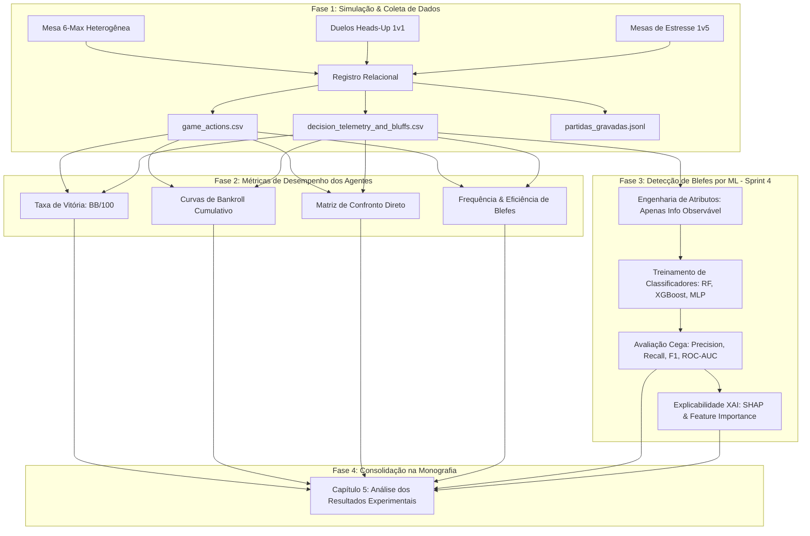
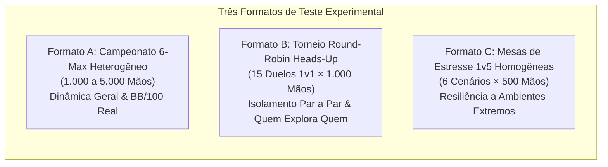

# Planejamento Experimental de Resultados: Simulações, Formatos e Detecção de Blefes no Texas Hold'em

**Projeto de Conclusão de Curso (TCC):** Modelagem de Agentes Inteligentes, Teoria dos Jogos e Detecção de Blefes em Jogos de Informação Imperfeita  
**Documento Metodológico:** Protocolo Experimental, Arquitetura de Campeonatos e Pipeline de Machine Learning  
**Data:** Novembro de 2026  
**Status:** Protocolo Homologado pela Auditoria Técnica (Rigor)  

---

## 1. Sumário Executivo

Este documento estabelece o **Plano Experimental Definitivo** para a geração, coleta, processamento e análise dos resultados empíricos do Trabalho de Conclusão de Curso. O objetivo central é responder a duas questões fundamentais da pesquisa:

1. **Eficiência e Lucratividade dos Agentes:** Como diferentes abordagens algorítmicas (Equilíbrio de Nash/GTO, Critério de Kelly Fracionário, Heurísticas Clássicas, Otimização Matemática e Algoritmos Genéticos Híbridos) performam competitivamente entre si em termos de taxa de vitória ($BB/100$) e preservação de bankroll?
2. **Dinâmica, Detecção e Explicabilidade de Blefes:** Como caracterizar formalmente a mecânica de blefes em jogos de informação imperfeita, mensurar sua taxa de sucesso empírico e construir modelos preditivos supervisionados de *Machine Learning* capazes de inferir blefes a partir de dados observáveis da mesa sem acesso às cartas fechadas (*hole cards*)?



---

## 2. Metodologia de Detecção e Análise de Blefes

O estudo do blefe no Texas Hold'em exige uma abordagem metodológica em camadas, distinguindo claramente o que é **fato real interno (Ground Truth)** do que é **inferência externa (Machine Learning)**.

### 2.1 Nível 1: Ground Truth (Verdade Fundamental do Simulador)

Em uma partida real, as cartas do adversário são desconhecidas até o showdown. No entanto, o simulador do TCC possui **visibilidade onisciente controlada para fins acadêmicos**:

* **Rotulagem Fidedigna:** No exato momento em que um agente decide apostar ou aumentar, o sistema inspeciona suas cartas fechadas e o estado do bordo comunitário.
* **Critério de Classificação de Blefe:**
  $$\text{IsBluff} = \begin{cases} 
  \text{True}, & \text{se } (\text{RawEquity} < \text{PotOdds}) \land (\text{Action} \in \{\text{BET}, \text{RAISE}\}) \land (\text{HandRank} \le \text{HIGH\_CARD}) \\
  \text{True}, & \text{se } \text{Agente ativou modo explícito de blefe (PURE\_BLUFF, SEMI\_BLUFF, BLOCKER)} \\
  \text{False}, & \text{se a aposta for motivada por valor real ou proteção com equidade favorável}
  \end{cases}$$
* **Campos Registrados na Telemetria:**
  - `is_bluff` (booleano): Verdade fundamental da ação.
  - `bluff_type` (categórico): Taxonomia detalhada da jogada.
  - `raw_equity` (float $[0, 1]$): Probabilidade real de vitória no momento da aposta.
  - `pot_odds` (float $[0, 1]$): Preço matemático exigido pelo pote.
  - `expected_value` (float): Expectativa matemática de lucro da decisão.
  - `tactical_reason` (texto): Racional cognitivo reportado pelo agente.

### 2.2 Nível 2: Taxonomia Científica dos Blefes

Os blefes executados são categorizados em cinco classes no banco de dados (`BluffType`):

| Tipo de Blefe | Descrição Teórica | Condição no Simulador | Exemplo Prático |
| :--- | :--- | :--- | :--- |
| **Blefe Puro (`PURE_BLUFF`)** | Aposta agressiva sem valor de confronto e sem perspectiva real de melhora nas próximas cartas. | Equidade $< 25\%$, sem pedidas formadas no bordo. | Apostar no River com $7\spadesuit 2\heartsuit$ em bordo $A\clubsuit K\diamondsuit Q\spadesuit 8\diamondsuit 3\clubsuit$. |
| **Semi-Blefe (`SEMI_BLUFF`)** | Aposta agressiva com mão atualmente fraca, mas com alto potencial de evolução para o melhor jogo (combinação de outs). | Equidade entre $25\%$ e $45\%$, com flush draw ou straight draw ativo ($\text{Outs} \ge 8$). | Aumentar no Flop com $J\heartsuit 10\heartsuit$ em bordo $9\heartsuit 2\heartsuit 5\spadesuit$. |
| **C-Bet (`CBET_BLUFF`)** | Aposta de continuação no Flop realizada pelo agressor pré-flop, independentemente de ter acertado o bordo. | Jogador foi o último agressor pré-flop; mão não formou par no Flop. | Dar raise pré-flop com $A\diamondsuit K\spadesuit$ e apostar no Flop $7\clubsuit 4\diamondsuit 2\spadesuit$. |
| **Roubo de Blinds (`STEAL_BLUFF`)** | Aumento pré-flop executado a partir de posições finais (Cutoff ou Botão) para forçar o descarte dos blinds. | Posição CO ou BTN; cartas marginais; mesa em fold até o jogador. | Aumentar de $2.5\text{ BB}$ no Botão com $K\diamondsuit 4\clubsuit$. |
| **Blefe com Blocker (`BLOCKER_BLUFF`)** | Blefe tático polarizado no River utilizando uma carta na mão que reduz matematicamente as chances do oponente ter a mão vencedora. | Jogador segura o Ás do naipe do Flush ou carta chave da Sequência sem completar o jogo. | Apostar forte no River segurando o $A\diamondsuit$ em bordo com 3 ouros. |

### 2.3 Nível 3: Reação do Oponente e Desfecho Econômico

Para cada tentativa de blefe, o pipeline registra automaticamente a reação imediata da mesa e o desfecho final da mão:

* **Resposta do Oponente (`OpponentResponse`):**
  - `ACCEPTED_ALL_FOLD`: Sucesso tático imediato — todos os oponentes descartaram suas mãos; o blefador recolheu o pote sem showdown.
  - `REFUSED_CALLED`: Oponente pagou a aposta (*bluff caught* ou pedida no Turn).
  - `REFUSED_RAISED`: Oponente contra-atacou com re-aumento (*re-bluff* ou aposta de valor monstro).
* **Desfecho da Mão (`BluffOutcome`):**
  - `SUCCESS_UNCONTESTED`: Pote vencido sem showdown.
  - `SUCCESS_CONVERTED`: Semi-blefe que completou o draw no Turn/River e venceu no showdown.
  - `FAILED_FOLDED_LATER`: Blefador foi obrigado a foldar em street posterior diante de pressão.
  - `FAILED_SHOWDOWN_LOST`: Chegou ao showdown e perdeu fichas para uma mão superior.

### 2.4 Nível 4: Detecção de Blefe por Machine Learning (Sprint 4)

Na Sprint 4, implementa-se o modelo preditivo que simula a perspectiva de um **adversário humano ou sistema de segurança anti-fraude**. O modelo **não tem acesso** a `is_bluff`, `hole_cards` ou `raw_equity`.

#### Matriz de Atributos Observáveis (Features de Entrada)

1. **Variáveis de Ação e Dimensionamento:**
   - `bet_ratio_pot`: Razão entre o valor apostado e o tamanho do pote atual ($B / P$).
   - `street`: Fase da mão ($0 = \text{Pré-Flop}, 1 = \text{Flop}, 2 = \text{Turn}, 3 = \text{River}$).
   - `action_type`: Aposta (`BET`) ou Aumento (`RAISE`).
   - `to_call_ratio`: Percentual do stack do oponente comprometido pela aposta.
2. **Variáveis de Contexto e Textura da Mesa:**
   - `board_suit_max`: Número máximo de cartas do mesmo naipe na mesa (indicador de risco de flush).
   - `board_is_paired`: Booleano indicando presença de par comunitário (risco de full house/trinca).
   - `board_connectedness`: Grau de proximidade de valores no bordo (risco de straight).
   - `active_players_count`: Quantidade de oponentes ainda ativos na mão.
3. **Variáveis Comportamentais e Históricas do Agente:**
   - `player_position`: Posição na mesa ($0 = \text{SB}, 1 = \text{BB}, 2 = \text{UTG}, \dots, 5 = \text{BTN}$).
   - `historical_vpip`: Taxa observada de participação voluntária no pote do jogador nas últimas 50 mãos.
   - `historical_pfr`: Taxa observada de aumento pré-flop nas últimas 50 mãos.
   - `previous_street_action`: Ação tomada pelo jogador na street imediatamente anterior (ex.: deu Check no Flop e deu Raise no Turn).

#### Modelos Classificadores & Métricas de Avaliação

* **Algoritmos Avaliados:**
  1. *Random Forest Classifier* (baseline robusta para dados tabulares heterogêneos).
  2. *XGBoost / LightGBM* (modelos de gradient boosting de alta capacidade de separação não-linear).
  3. *Regressão Logística com Regularização L2* (baseline linear para calibração de probabilidade).
  4. *Multi-Layer Perceptron (MLP)* (rede neural densa de 3 camadas).
* **Métricas Mandatórias de Avaliação:**
  - **F1-Score Ponderado e F1-Score da Classe Positiva (Blefe):** Métrica primordial devido ao desbalanceamento natural de classes (a maioria das apostas é por valor).
  - **Precision:** Percentual de alertas de blefe que eram realmente blefes ($\frac{TP}{TP + FP}$).
  - **Recall:** Capacidade do modelo de capturar todos os blefes ocorridos ($\frac{TP}{TP + FN}$).
  - **ROC-AUC & Curva Precision-Recall (PR-AUC):** Qualidade da probabilidade contínua predita.
  - **Matriz de Confusão Normalizada:** Taxa de falsos positivos e falsos negativos.
* **Explicabilidade (XAI):**
  - Utilização da biblioteca `SHAP` (*SHapley Additive exPlanations*) para gerar gráficos de sumário de atributos (*beeswarm plot* e *waterfall plot*), demonstrando quais fatores levaram o modelo a diagnosticar que uma aposta era blefe.

---

## 3. Formatos de Experimentação & Desenho Amostral

Para isolar variáveis e garantir validade estatística perante a banca acadêmica, o plano experimental divide-se em **três formatos complementares**:



---

### 3.1 Formato A: Campeonato Geral 6-Max (Mesa Heterogênea)

Este é o **formato principal da dissertação**, reproduzindo uma mesa cheia de poker com diversidade de estilos.

* **Composição dos Assentos (6 Jogadores Únicos):**
  1. **Assento 1:** [`GhBlufferAgent`](file:///C:/Users/T-Gamer/Desktop/Poker-TCC/src/agents/gh_bluffer_agent.py) (Estado-da-Arte GTO Nash / Remoção de Cartas).
  2. **Assento 2:** [`GhMathAgent`](file:///C:/Users/T-Gamer/Desktop/Poker-TCC/src/agents/gh_math_agent.py) (Critério de Kelly Fracionário / RFI Posicional).
  3. **Assento 3:** [`BlufferAgent`](file:///C:/Users/T-Gamer/Desktop/Poker-TCC/src/agents/bluffer_agent.py) (Modelo Heurístico de Pressão / Calibrado).
  4. **Assento 4:** [`MathematicalAgent`](file:///C:/Users/T-Gamer/Desktop/Poker-TCC/src/agents/mathematical_agent.py) (Baseline Teórica Invariante / +EV Estrito).
  5. **Assento 5:** [`HybridAgent`](file:///C:/Users/T-Gamer/Desktop/Poker-TCC/src/agents/hybrid_agent.py) (Modelo Campeão Treinado: `Híbrido Mestre v2`).
  6. **Assento 6:** [`HeuristicAgent`](file:///C:/Users/T-Gamer/Desktop/Poker-TCC/src/agents/heuristic.py) (Grupo de Controle: Jogador Equilibrado / Recreativo).
* **Parâmetros da Mesa:**
  - Stack Inicial por Mão: $1.000$ fichas ($100\text{ BB}$).
  - Small Blind: $5$ fichas | Big Blind: $10$ fichas.
  - Rotação Contínua de Botão a cada mão (garantindo que todos joguem exatamente as mesmas proporções em cada posição).
* **Volume Amostral Recomendado:**
  - **Cenário Padrão:** $1.000$ mãos contínuas com semente fixada (`--seed 42`).
  - **Cenário de Alta Significância:** $5$ baterias de $1.000$ mãos ($5.000$ mãos totais) com sementes diferentes (`42, 101, 777, 1234, 9999`) para cálculo de intervalo de confiança de $95\%$.
* **Métricas Extraídas:**
  - Taxa de Vitória ($BB/100$ e Potes Ganhos).
  - VPIP, PFR, Fator de Agressão ($AF = \frac{\text{Bets} + \text{Raises}}{\text{Calls}}$).
  - Frequência de Blefe executada vs Frequência de Blefes bem-sucedidos.
  - Curva de Bankroll Cumulativo ao longo das mãos.

---

### 3.2 Formato B: Torneio Round-Robin Heads-Up (Duelos Diretos 1 vs 1)

O formato 6-Max possui ruído de terceiros (quando dois agentes entram em confronto e um terceiro folda). O formato Heads-Up isola puramente a superioridade tática de um agente sobre o outro.

* **Estrutura:**
  - Total de agentes: $6$.
  - Total de confrontos: $\binom{6}{2} = 15$ duelos diretos.
* **Protocolo de Pareamento:**
  - Cada duelo consiste em $500$ mãos (ou $1.000$ mãos divididas igualmente entre quem joga no Botão/SB e quem joga no BB).
  - Stack reiniciado a cada mão ou com recomposição automática caso um jogador caia abaixo de $20\text{ BB}$.
* **Saída Gráfica na Monografia:**
  - **Matriz Triangular de Dominância ($15 \times 15$ ou $6 \times 6$):** Cada célula exibe o $BB/100$ líquido obtido pelo Agente da Linha contra o Agente da Coluna.
  - Revela ciclos de exploração do tipo *pedra-papel-tesoura* (ex.: Blefador explora Matemático, Matemático explora Heurístico, Heurístico pune Blefador).

---

### 3.3 Formato C: Mesas de Estresse Homogêneas (1 Alvo vs 5 Clones)

Projetado para responder à pergunta clássica de bancas de computação: *"O agente é robusto quando colocado em um ecossistema hostil de estilo único?"*

* **Cenário C1 (Teste de Pressão Agressiva):**
  - $1 \times$ [`MathematicalAgent`](file:///C:/Users/T-Gamer/Desktop/Poker-TCC/src/agents/mathematical_agent.py) vs $5 \times$ [`BlufferAgent`](file:///C:/Users/T-Gamer/Desktop/Poker-TCC/src/agents/bluffer_agent.py).
  - *Hipótese:* O agente matemático sofrerá com over-folding no pré-flop, mas quando pagar, extrairá stacks completos com mãos de valor superior.
* **Cenário C2 (Teste contra Mesa Passiva / Calling Stations):**
  - $1 \times$ [`GhBlufferAgent`](file:///C:/Users/T-Gamer/Desktop/Poker-TCC/src/agents/gh_bluffer_agent.py) vs $5 \times$ [`HeuristicAgent`](file:///C:/Users/T-Gamer/Desktop/Poker-TCC/src/agents/heuristic.py) configurados no perfil passivo.
  - *Hipótese:* Blefes puros sofrerão alta taxa de recusa; o agente GTO precisará modular suas frequências para sobreviver.
* **Volume:** $300$ a $500$ mãos por cenário.

---

## 4. Protocolo Operacional de Execução dos Scripts

A execução dos experimentos e geração de artefatos é totalmente automatizada pelos scripts do repositório:

### 4.1 Passo 1: Geração do Campeonato 6-Max e Telemetria de Blefes

Para executar a simulação heterogênea completa e gravar os datasets relacionais:

```bash
# Executa 1.000 mãos com a mesa do TCC e gera as tabelas CSV e gráficos
.venv\Scripts\python.exe scripts/generate_decision_telemetry.py `
    --hands 1000 `
    --roster hybrid_vs_champions `
    --seed 42 `
    --output-dir data
```

> **Arquivos Gerados:**  
> - `data/game_actions.csv` (histórico físico de cada aposta, pote e stack).  
> - `data/decision_telemetry_and_bluffs.csv` (telemetria cognitiva, equidade e rotulagem de blefe).  
> - Diretório `data/test_<timestamp>_.../` contendo o backup imutável da bateria.

### 4.2 Passo 2: Benchmark Estatístico Direto entre Modelos

Para obter o confronto detalhado entre o modelo GTO e os demais modelos:

```bash
# Benchmark GTO Nash vs Agentes Clássicos (1.000 mãos, semente 42)
.venv\Scripts\python.exe scripts/benchmark_gh_agent.py --hands 1000 --seed 42
```

### 4.3 Passo 3: Geração dos Gráficos de Alta Resolução (300 DPI)

Para compilar os gráficos científicos prontos para inserção no LaTeX/Word do TCC:

```bash
.venv\Scripts\python.exe scripts/plot_championship_results.py
```

> **Gráficos Gerados:**  
> 1. `1_vitorias_por_agente.png` (Taxa de vitórias e potes ganhos).  
> 2. `2_evolucao_bankroll.png` (Curva temporal de saldo de fichas mão a mão).  
> 3. `3_matriz_confronto_direto.png` (Heatmap de transferência líquida de fichas entre perfis).  
> 4. `4_analise_blefes.png` (Painel anatômico: frequência por tipo de blefe e aceitação vs recusa).  
> 5. `dashboard_consolidado_tcc.png` (Painel executivo 2x2 para a apresentação de slides da banca).

---

## 5. Dicionário dos Principais Indicadores Científicos

| Métrica | Notação / Fórmula | Significado Acadêmico no Poker | Valor de Referência Esperado |
| :--- | :---: | :--- | :---: |
| **Win Rate** | $\text{BB}/100 = \frac{\Delta \text{Bankroll} / \text{BB}}{\text{Mãos}} \times 100$ | Lucratividade padronizada a cada 100 mãos. | $> +5.0\text{ BB/100}$ (Vencedor Sólido) |
| **VPIP** | $\frac{N_{\text{ações voluntárias no pré-flop}}}{N_{\text{mãos totais}}}$ | Volatilidade e agressividade de entrada na mão. | $20\% \text{ a } 28\%$ (Ideal em 6-max) |
| **PFR** | $\frac{N_{\text{aumentos no pré-flop}}}{N_{\text{mãos totais}}}$ | Postura agressiva de liderança no pré-flop. | $16\% \text{ a } 24\%$ |
| **Fator de Agressão** | $AF = \frac{\text{Bets} + \text{Raises}}{\text{Calls}}$ | Razão entre agressão ativa e passividade. | $2.0 \text{ a } 4.0$ |
| **Frequência de Blefe** | $f_{\text{bluff}} = \frac{N_{\text{blefes}}}{N_{\text{apostas/aumentos}}}$ | Proporção de jogadas agressivas sem valor. | $20\% \text{ a } 35\%$ |
| **Taxa de Sucesso do Blefe** | $S_{\text{bluff}} = \frac{N_{\text{folds induzidos}}}{N_{\text{blefes totais}}}$ | Eficiência em fazer oponentes desistirem. | $> 45\%$ |
| **Lucro Líquido por Blefe** | $\text{EV}_{\text{bluff}} = \frac{\sum \Delta \text{Chips}_{\text{blefe}}}{N_{\text{blefes}}}$ | Fichas médias conquistadas ou perdidas por blefe. | $> 0$ fichas |

---

## 6. Checklist de Execução para a Finalização do TCC

- [x] **Agentes Corrigidos e Homologados:** 154 testes unitários passando, sem chamadas no River sem jogo e sem $P(\text{Blefe}\mid\text{Raise})=1.0$.
- [x] **Auditoria Prévia do Rigor Concluída:** Parecer conclusivo aprovando a prontidão do ecossistema.
- [ ] **Execução da Bateria de 1.000 Mãos (Campeonato 6-Max):** Executar `generate_decision_telemetry.py` com semente controlada.
- [ ] **Geração dos Gráficos Definitivos (300 DPI):** Executar `plot_championship_results.py` e arquivar imagens no diretório de figuras do TCC.
- [ ] **Treinamento dos Classificadores de Machine Learning (Sprint 4):**
  - [ ] Dividir `decision_telemetry_and_bluffs.csv` em treino (70%) e teste (30%).
  - [ ] Treinar Random Forest, XGBoost e Regressão Logística.
  - [ ] Plotar Curva ROC e Matriz de Confusão de detecção de blefe.
  - [ ] Gerar gráfico de importância de variáveis com SHAP.
- [ ] **Redação do Capítulo de Resultados:** Preenchimento das tabelas e análise dos gráficos na monografia.
