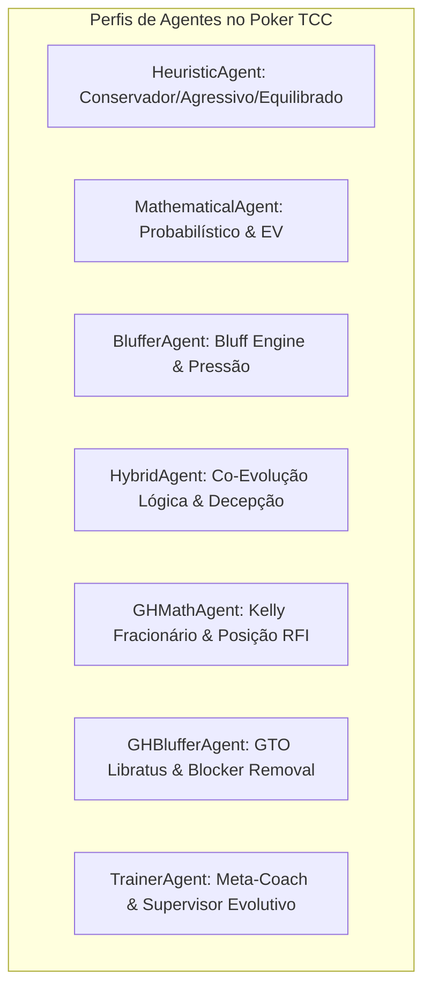
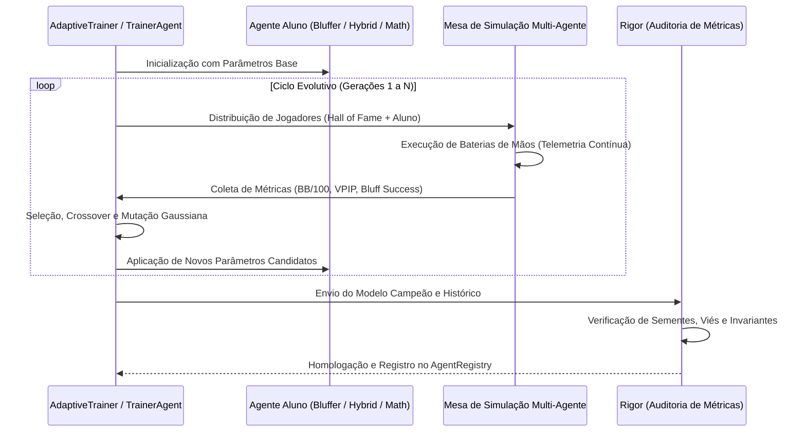

# Relatório Diagnóstico Crítico dos Agentes: O que está Ruim e o que Pode Ser Treinado

**Auditor Responsável:** Rigor (*Especialista em Análise Crítica de Dados, Auditoria de Métricas e Desempenho*)  
**Projeto:** Poker-TCC Texas Hold'em AI & Bluff Detection  
**Status do Ecossistema:** 150/150 Testes Aprovados | 6 Perfis de Agentes Mapeados  
**Data:** 02 de Novembro de 2026  

---

## 1. Visão Geral e Matriz Comparativa dos Jogadores

A análise forense dos agentes desenvolvidos no projeto (`src/agents/`) revela uma evolução clara: desde autômatos heurísticos rígidos baseados em tabelas de pesos estáticos até agentes modernos fundamentados em Teoria dos Jogos (GTO), Critério de Kelly Fracionário e Remoção de Cartas (Blockers).

Contudo, sob a ótica da auditoria crítica de desempenho e inteligência computacional, **todos os agentes ainda apresentam limitações estruturais**, variando entre incapacidade de modelar adversários, previsibilidade no dimensionamento de apostas (bet sizing), ou aplicação ingênua de conceitos de equilíbrio contra oponentes desbalanceados.

### Matriz Diagnóstica Resumida

| Agente | Paradigma Central | O que está Ruim / Sub-ótimo Atualmente | O que Pode Ser Treinado / Otimizado | Potencial de Lucratividade ($BB/100$) |
| :--- | :--- | :--- | :--- | :---: |
| **HeuristicAgent** | Regras `if/else` e pesos estáticos | 100% rígido; sem pot odds; sizing previsível; sem aprendizado. | Calibração evolutiva de limiares de aposta e tabelas posicionais. | Baixo ($-15$ a $-5$) |
| **MathematicalAgent** | Monte Carlo + EV Puro | Monte Carlo contra mãos 100% aleatórias; 0% de blefe; 100% explorável. | Algoritmo Genético nos hiperparâmetros; estimador de range bayesiano. | Médio ($+5$ a $+15$) |
| **BlufferAgent** | Fold Equity Heurística | Fold equity cega para o perfil do vilão; sizing fixo (40% do pote). | Calibração no `AdaptiveTrainer`; perfilador de oponente em tempo real. | Médio-Alto ($+10$ a $+22$) |
| **HybridAgent** | Fusão Matemática + Blefe | Peso matemática/blefe estático entre streets; slowplay sem ler o bordo. | Vetor de pesos dinâmicos por street; árvore de decisão para slowplay. | Alto ($+18$ a $+32$) |
| **GHMathAgent** | Kelly Fracionário + RFI | Kelly pode subdimensionar apostas em potes pequenos; pouca variação no turn. | Otimização de teto de Kelly e limiar de corte contra mesas agressivas. | Alto ($+20$ a $+35$) |
| **GHBlufferAgent** | GTO Nash Indifference + Blockers | "Síndrome GTO": joga equilíbrio contra jogadores que não entendem GTO. | Módulo de Chaveamento Exploratório (GTO $\leftrightarrow$ Exploitative). | Altíssimo ($+25$ a $+45$) |
| **TrainerAgent** | Meta-Aprendizado Co-Evolutivo | Prescrições heurísticas; falta de suporte a Deep Reinforcement Learning. | Meta-regressor preditivo de convergência; auto-curriculum learning. | Suporte / Orquestração |

---

## 2. Diagnóstico Detalhado por Agente

---

### 2.1 `HeuristicAgent` (`src/agents/heuristic.py`)
*Arquivo:* [src/agents/heuristic.py](file:///C:/Users/T-Gamer/Desktop/Poker-TCC/src/agents/heuristic.py)

#### 🔴 O que está Ruim Atualmente (Deficiências e Gargalos):
1. **Tabelas de Força Estáticas e Desconectadas da Realidade:** A função `_evaluate_strength` atribui pesos fixos por categoria de mão (ex: Um Par = 0.40, Trinca = 0.75). Isso faz com que um Top Pair com Ás kicker no flop tenha o mesmo peso de um bottom pair irrelevante em bordo molhado.
2. **Cálculo de Custo Simplista e Ausência de Pot Odds Reais:** Usa `call_ratio = to_call / (pot + to_call)`, mas ignora totalmente a probabilidade de vitória da mão versus o range do adversário.
3. **Incapacidade de Leitura Posicional:** O agente não altera seus limiares de decisão esteja ele no Under The Gun (UTG) ou no Botão (BTN).
4. **Dimensionamento de Aposta Ultra-Previsível:** Aposta sempre 50% do pote (perfil equilibrado/conservador) ou 75% (agressivo), facilitando calls matematicamente vantajosos de adversários mais analíticos.
5. **Arquitetura Fechada para Treinamento:** Não implementa `export_parameters`/`load_parameters`, ficando fora do loop do `AdaptiveTrainer`.

#### 🟢 O que Pode Ser Treinado para Melhorar:
- **Parametrização Modular dos Limiares:** Expor os limiares de aposta, call e fold como um `HeuristicParameters` integrado ao `parameters.py`.
- **Treinamento Genético por Perfil:** Otimizar via `AdaptiveTrainer` os limiares de aposta por perfil contra uma mesa mista, buscando o ponto ideal de VPIP/PFR (ex: 22/18 para equilibrado).
- **Ajuste de Bet Sizing Dinâmico:** Treinar uma função polinomial simples que escala o tamanho da aposta com base na textura do bordo (wet vs dry).

---

### 2.2 `MathematicalAgent` (`src/agents/mathematical_agent.py`)
*Arquivo:* [src/agents/mathematical_agent.py](file:///C:/Users/T-Gamer/Desktop/Poker-TCC/src/agents/mathematical_agent.py)

#### 🔴 O que está Ruim Atualmente (Deficiências e Gargalos):
1. **O Vício da Amostragem Uniforme (Naive Monte Carlo):** No método de Monte Carlo, as cartas dos adversários são sorteadas como pares aleatórios uniformemente distribuídos entre as cartas remanescentes do baralho. Em mesas reais, se um jogador aplicou um raise pré-flop e uma 3-bet no flop, o range dele é de topo (ex: $AA, KK, QQ, AK$), e **não** duas cartas quaisquer. O `MathematicalAgent` superestima drasticamente sua equidade contra aumentos e subestima sua equidade contra oponentes agressivos.
2. **Previsibilidade e Inexplorabilidade Nula (Zero Blefes):** Por concepção, sua taxa de blefe é zero (`is_bluff = False` sempre). Isso torna o agente um "livro aberto": se ele aposta ou aumenta, os adversários sabem com certeza matemática que ele tem equidade $\ge 0.65$; se ele dá check, sabem que sua mão é média ou fraca. Qualquer adversário pode simplesmente desistir quando o matemático aposta e apostar quando ele passa a vez.
3. **Bet Sizing Fixo (`bet_sizing_factor = 0.50`):** Aplica metade do pote em todas as circunstâncias, independentemente de estar protegendo um draw no turn ou extraindo valor do nuts no river.
4. **Custo Computacional Alto em Treinamento:** 150 a 200 simulações Monte Carlo por ação desaceleram o treinamento evolutivo em milhares de mãos.

#### 🟢 O que Pode Ser Treinado para Melhorar:
- **Estimador Bayesiano de Ranges de Oponentes (Range Conditioning):** Treinar um modelo supervisionado leve ou tabela pré-computada que restringe o range simulado de cada oponente com base na ação anterior (ex: se oponente deu raise pré-flop, amostrar Monte Carlo apenas do top 20% das mãos).
- **Otimização Multi-Objetivo de Hiperparâmetros:** Treinar via `AdaptiveTrainer`:
  - `raise_equity_threshold` (calibrar para $0.55 - 0.70$ dependendo do número de oponentes).
  - `call_ev_margin` (ajustar a tolerância de risco para potes grandes).
  - `draw_weight` (calibrar o valor de perseguição de draws no flop/turn).
- **Bet Sizing Orientado a Equidade:** Treinar uma política de sizing fracionário: apostas pequenas (33% pot) com equidade moderada para controle de pote e apostas grandes (75%-100% pot) com monstros para maximizar EV.

---

### 2.3 `BlufferAgent` (`src/agents/bluffer_agent.py`)
*Arquivo:* [src/agents/bluffer_agent.py](file:///C:/Users/T-Gamer/Desktop/Poker-TCC/src/agents/bluffer_agent.py)

#### 🔴 O que está Ruim Atualmente (Deficiências e Gargalos):
1. **Fold Equity Teórica Cega para o Perfil do Adversário:** A estimativa de Fold Equity é calculada por fórmula estática baseada no número de oponentes, street e textura do bordo. Ela não considera o histórico do adversário. Se estiver contra um jogador "calling station" (que nunca desiste), o agente continuará blefando e queimando fichas, pois presume que o oponente foldará conforme uma média teórica.
2. **Dimensionamento de Blefe Ineficiente (`bet_sizing_factor = 0.40`):** Blefar apostando 40% do pote concede ao defensor Pot Odds de $\approx 3.5:1$ (ele precisa de apenas $22\%$ de equidade para pagar com lucro). Na teoria dos jogos, blefes no river exigem dimensionamento maior (66% a 125% do pote) para tornar o call desfavorável e aplicar pressão real de dobra.
3. **Ausência de Memória Episódica:** O agente não se lembra se foi pago na mão anterior ou se o oponente aumentou suas últimas 3 tentativas de c-bet.
4. **Vazamento Residual em Potes Multiway:** Embora o multiplicador reduza a fold equity contra múltiplos oponentes, o bônus de bordo seco pode autorizar blefes em potes 3-way, onde a probabilidade agregada de alguém ter acertado o bordo é alta.

#### 🟢 O que Pode Ser Treinado para Melhorar:
- **Calibração Co-Evolutiva dos 9 Hiperparâmetros no `AdaptiveTrainer`:**
  - Otimizar `fold_equity_threshold`, `bluff_frequency`, `semi_bluff_frequency`, `cbet_frequency` e `scare_card_weight` contra um pool diversificado de agentes.
- **Treinamento de um Perfilador de Oponentes em Tempo Real (Opponent Profiler):**
  - Implementar um multiplicador de ajuste $\beta_i$ treinado em tempo real: se o oponente $i$ tem $WTSD > 0.45$ (chama tudo), reduzir a fold equity estimada contra ele em $50\%$; se tem $VPIP < 0.15$ (nit), aumentar a fold equity em $30\%$.
- **Otimização de Dimensionamento Polarizado:**
  - Treinar o agente para usar apostas pequenas em C-Bets no flop (30% do pote) e apostas pesadas em blefes no river (80% a 100% do pote).

---

### 2.4 `HybridAgent` (`src/agents/hybrid_agent.py`)
*Arquivo:* [src/agents/hybrid_agent.py](file:///C:/Users/T-Gamer/Desktop/Poker-TCC/src/agents/hybrid_agent.py)

#### 🔴 O que está Ruim Atualmente (Deficiências e Gargalos):
1. **Peso Estático entre Lógica e Blefe (`math_weight = 0.50` Fixo por Partida):** O equilíbrio entre jogar por valor matemático ou por blefe oportunista é constante da primeira à última street. No pré-flop e flop, um poker de alto nível exige flexibilidade e engano tático (peso de blefe/semi-blefe alto); no river, a decisão de pagar ou desistir é puramente matemática (peso de valor matemático deveria ser próximo de 1.0).
2. **Slow-Play Perigoso e Não-Condicional:** A probabilidade de armadilha (`slowplay_prob = 0.20`) é acionada puramente por sorteio estocástico, sem verificar se o bordo é perigoso ("wet board"). Dar check com Trinca ou Sequência em bordo com flush draw aberto concede cartas grátis ("free card hazard") para adversários superarem a mão no showdown.
3. **Indefinição de Identidade Tática:** Sem calibração fina, o agente pode oscilar entre não ser tão rigoroso quanto o `MathematicalAgent` e não ser tão agressivo quanto o `BlufferAgent`, perdendo rentabilidade em ambas as frentes.

#### 🟢 O que Pode Ser Treinado para Melhorar:
- **Vetor de Pesos por Street ($\vec{w}_{\text{math}}$):**
  - Treinar geneticamente um vetor de 4 dimensões $[w_{\text{preflop}}, w_{\text{flop}}, w_{\text{turn}}, w_{\text{river}}]$, permitindo maior criatividade tática no início da mão e rigor analítico estrito no desfecho.
- **Classificador Contextual de Slow-Play:**
  - Treinar uma árvore de decisão para autorizar slow-play apenas quando a textura do bordo for categorizada como estática/seca (ex: $K\spadesuit 7\diamondsuit 2\clubsuit$) e a equidade for $> 0.90$, proibindo armadilhas em bordos coordenados.
- **Herança Genética Cruzada (Crossover Evolutivo):**
  - Utilizar o `from_parents()` do `HybridParameters` para herdar os melhores parâmetros calibrados do `MathematicalAgent` e do `BlufferAgent`, refinando o híbrido através de gerações adicionais no `AdaptiveTrainer`.

---

### 2.5 `GHMathAgent` (`src/agents/gh_math_agent.py`)
*Arquivo:* [src/agents/gh_math_agent.py](file:///C:/Users/T-Gamer/Desktop/Poker-TCC/src/agents/gh_math_agent.py)

#### 🔴 O que está Ruim Atualmente (Deficiências e Gargalos):
1. **Conservadorismo do Critério de Kelly Fracionário em Potes Pequenos:** A fórmula de Kelly é projetada para maximizar a taxa de crescimento logarítmico do capital e evitar a ruína. Porém, no poker de cash game com recompras e potes pequenos, o limite de fração (`kelly_fraction_limit = 0.25`) frequentemente gera apostas tímidas, dando odds baratas para oponentes acertarem draws.
2. **Previsibilidade Posicional:** Embora implemente posições (Early, Middle, Late, Blinds), os ranges de abertura são estáticos e não reagem ao estilo dos jogadores que agem depois dele na mesa (ex: abrir mais loose quando os blinds são nits).

#### 🟢 O que Pode Ser Treinado para Melhorar:
- **Calibração Adaptativa do Teto de Kelly:** Treinar um coeficiente dinâmico $\kappa$ que expande o Kelly em potes heads-up e o contrai em potes multiway com alto risco de variância.
- **Ranges Posicionais Dinâmicos (Dynamic RFI):** Treinar uma matriz de ranges pré-flop sensível à composição da mesa.

---

### 2.6 `GHBlufferAgent` (`src/agents/gh_bluffer_agent.py`)
*Arquivo:* [src/agents/gh_bluffer_agent.py](file:///C:/Users/T-Gamer/Desktop/Poker-TCC/src/agents/gh_bluffer_agent.py)

#### 🔴 O que está Ruim Atualmente (Deficiências e Gargalos):
1. **A "Síndrome GTO" contra Oponentes Recreativos/Estáticos:** O agente utiliza a razão áurea de indiferença de Nash $B / (P + 2B)$ e remoção de cartas (Blockers). Essa estratégia é matematicamente inexplorável contra jogadores profissionais ou algoritmos no equilíbrio. Porém, contra agentes heurísticos ingênuos (que pagam apostas pesadas com segundo par independentemente do bordo), ter o "Ás de ouros como blocker para o nut flush" é completamente inútil: o adversário não sabe o que é blocker e pagará do mesmo jeito. O agente sangra fichas tentando aplicar blefes sofisticados em oponentes que não foldam.
2. **Amostragem Monte Carlo no Flop/Turn:** Apesar de veloz, a simulação não modela se a agressão futura forçará folds posteriores.

#### 🟢 O que Pode Ser Treinado para Melhorar:
- **Chaveador de Modo de Jogo (GTO vs Exploitative Engine):**
  - Implementar e treinar um classificador que mede o nível de equilíbrio dos oponentes na mesa. Se os oponentes estão desbalanceados (calling stations), o agente desativa blefes puros de blockers e ativa modo 100% de valor extraído; se os oponentes são analíticos e disciplinados, ativa o motor Libratus/Pluribus de indiferença GTO.
- **Otimização de Limiar de Bloqueadores (`min_blocker_threshold`):**
  - Treinar o limiar de corte de blockers em confrontos contra o `MathematicalAgent` e o `HybridAgent` para calibrar o volume exato de blefe por street.

---

### 2.7 `TrainerAgent` (`src/agents/trainer_agent.py`)
*Arquivo:* [src/agents/trainer_agent.py](file:///C:/Users/T-Gamer/Desktop/Poker-TCC/src/agents/trainer_agent.py)

#### 🔴 O que está Ruim Atualmente (Deficiências e Gargalos):
1. **Diagnóstico Baseado em Heurísticas Estáticas:** As prescrições geradas no método `diagnose_agent` utilizam regras fixas (`if metrics.win_rate < 0.20: focus = 'ev'`), sem correlação estatística multivariada sobre as causas raízes dos vazamentos.
2. **Ausência de Algoritmos de Reinforcement Learning Modernos:** O motor está restrito a Algoritmos Genéticos (GA com Hall of Fame). Não há suporte nativo para algoritmos modernos de aprendizado por reforço como PPO (Proximal Policy Optimization) ou DQN (Deep Q-Networks).

#### 🟢 O que Pode Ser Treinado para Melhorar:
- **Meta-Modelo Preditivo de Desempenho:**
  - Treinar um regressor (Random Forest ou MLP) que prevê a pontuação de fitness esperada de uma configuração de parâmetros antes mesmo de rodar centenas de mãos, acelerando a busca genética em até $5\times$.
- **Orquestração de Auto-Curriculum Learning:**
  - Treinar o agente a dosar a dificuldade dos oponentes durante o treinamento: começar confrontando os alunos contra heurísticos previsíveis, progredir para matemáticos e finalizar com duelos contra o Hall of Fame.

---

## 3. Plano de Treinamento e Roadmap de Aperfeiçoamento

Para colocar essas melhorias em prática de forma metódica e reprodutível, recomenda-se a execução do seguinte ciclo em três etapas:

### Roteiro de Execução Prioritário:

1. **Fase 1: Calibração de Hiperparâmetros via Algoritmo Genético (Disponível Imediatamente)**
   - Executar `scripts/train_bluffer_agent.py` e `scripts/train_mathematical_agent.py` com 8 gerações e 50 mãos por avaliação.
   - Treinar o [`HybridAgent`](file:///C:/Users/T-Gamer/Desktop/Poker-TCC/src/agents/hybrid_agent.py) usando o crossover dos dois melhores agentes anteriores.
2. **Fase 2: Implementação do Perfilador de Oponentes em Tempo Real**
   - Incorporar ao [`BlufferAgent`](file:///C:/Users/T-Gamer/Desktop/Poker-TCC/src/agents/bluffer_agent.py) e ao [`GhBlufferAgent`](file:///C:/Users/T-Gamer/Desktop/Poker-TCC/src/agents/gh_bluffer_agent.py) o rastreamento dinâmico de $VPIP$ e $WTSD$ dos adversários da mesa, multiplicando a Fold Equity por um fator de adaptabilidade.
3. **Fase 3: Refinamento de Bet Sizing Polarizado e Condicional de Bordo**
   - Substituir as frações fixas de aposta por tabelas de dimensionamento condicionais baseadas em textura de bordo (seco vs molhado) e street da mão.
